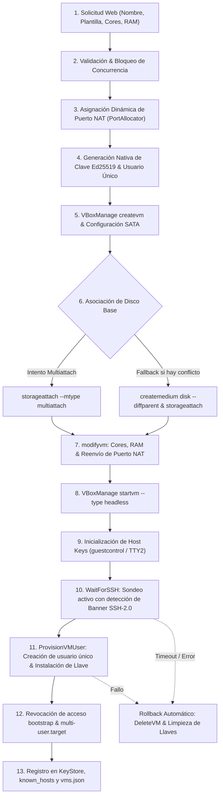

# SSH Web Terminal, Virtual Machine & Docker Manager

Aplicación web interactiva en tiempo real para emulación de terminal SSH, gestión integral de **Máquinas Virtuales en Oracle VirtualBox 7.2** sobre host remoto Windows, y **administración de Contenedores Docker nativos dentro de las máquinas virtuales Linux**.

El sistema implementa aprovisionamiento automatizado a partir de **plantillas base con discos Multiattach y discos diferenciales**, generación criptográfica nativa de claves **Ed25519**, verificación estricta de `known_hosts`, túnel SSH transparente con PTY completa, y un motor de contenerización remota que opera 100% dentro de las máquinas virtuales invitadas sin requerir Docker en el host Windows.

---

## 📋 Características Principales

### 🐳 1. Gestión de Docker en VMs Linux (Contenedores e Imágenes)
- **Cero Docker en el Host Windows**: Todos los contenedores e imágenes se construyen y ejecutan exclusivamente dentro del motor Docker de las máquinas virtuales Linux. El host Windows no requiere tener Docker instalado.
- **Túnel SSH y Ejecución Segura**: Las operaciones Docker se canalizan mediante el túnel SSH hacia la máquina virtual con validación estricta contra inyección de comandos, escapado POSIX con comillas simples y ejecución controlada vía `sudo docker`.
- **Navegación Docker Integrada (Submenú Contenedores / Imágenes)**:
  - Al seleccionar **Docker** en el menú principal, se despliegan las opciones de **Contenedores** e **Imágenes**.
  - **Filtro dinámico por Máquina Virtual**: Permite consultar todos los recursos o filtrar por una VM específica.
  - **Indicador de Salud Docker en Vivo**: Muestra si el daemon de Docker está activo y su versión en la VM seleccionada.
- **Módulo de Imágenes Docker**:
  - **Listado detallado**: Visualiza Repository, Tag, Image ID, Tamaño y fecha de creación.
  - **Acción "Ejecutar"**: Abre el asistente de creación de contenedor con la imagen preseleccionada para configurar puertos, volúmenes y variables antes de desplegar.
  - **Acción "Eliminar"**: Modal de confirmación con opción de forzado (`--force`) y reporte claro de errores de Docker en caso de conflicto con contenedores activos.
  - **Creación / Compilación de Imágenes (`+ Crear imagen`)**:
    - Soporte para **subir archivo Dockerfile** (con dropzone interactivo) o **pegar directamente las instrucciones** en editor monoespaciado.
    - Acciones: **Crear imagen** (construye en la VM con limpieza automática del contexto temporal en `/tmp`) o **Crear y ejecutar** (compila e inmediatamente abre el asistente para desplegar el contenedor).
- **Asistente Visual de Contenedores con Selección de Origen**:
  - **Paso 1 (VM y Origen)**: Pregunta inicial: *¿De dónde quieres crear el contenedor?*:
    - **Usar una imagen**: Lista las imágenes disponibles en la VM seleccionada con botón de acceso rápido para `+ Crear nueva imagen`.
    - **Aplicaciones**: Flujo visual de categorías (*Bases de Datos, Servidores Web, Mensajería, Caché, Desarrollo o Personalizado*) y plantillas preconfiguradas.
  - **Paso 2 (Plantilla / Imagen)**: Selección de plantilla si se eligió el catálogo.
  - **Paso 3 (Configuración Dinámica)**: Configuración de nombre, política de reinicio (`unless-stopped`, `always`, `on-failure`, `no`), imagen Docker, mapeo de puertos (`Host -> Contenedor`), variables de entorno (`KEY = VALUE`) y volúmenes de almacenamiento persistente (`Host Path -> Container Path`).
  - **Paso 4 (Resumen)**: Tarjeta de revisión de parámetros antes de ordenar la creación.
- **Ciclo de Vida Completo de Contenedores**:
  - Iniciar contenedores detenidos, detenerlos y reiniciarlos.
  - **Visor de Logs**: Consulta de líneas recientes (`100`, `200`, `500`, `1000`) con actualización inmediata.
  - **Inspección de Detalles**: Consulta de ID, IP interna, puertos, montajes de volúmenes y variables de entorno.
  - **Eliminación Segura**: Modal de confirmación con soporte para forzado (`--force`).
- **Terminal Interactiva Directa (`docker exec`)**:
  - Botón **Consola** en la tarjeta del contenedor para ingresar inmediatamente a una shell interactiva Bash o Sh dentro del contenedor (`docker exec -it <container> ...`) sobre WebSocket y emulación PTY con soporte ANSI completo.

---

### 🖥️ 2. Gestión Integral de Máquinas Virtuales (VirtualBox 7.2)
- **Aprovisionamiento Instantáneo mediante Plantillas Base**: Múltiples máquinas virtuales comparten un único disco base en modo lectura con discos diferenciales.
- **Compatibilidad con VirtualBox 7.2**: Si VirtualBox restringe la asociación directa por estado del medio (`MultiAttach compatibility`), el sistema aprovisiona automáticamente un disco diferencial hijo (`--diffparent`), garantizando que la plantilla original jamás se modifique ni se corrompa.
- **Aprovisionamiento Automático de Identidad (Zero-Touch Provisioning)**:
  - Generación nativa en Go de pares de claves **Ed25519** (OpenSSH / PKCS#8 PEM) exclusivas para cada VM.
  - Derivación de usuario Linux único no colisionable (ej. `vm_servidor_8c40`).
  - Inicialización automática de llaves de host SSH en el primer arranque mediante `VBoxManage guestcontrol` o secuencia en consola virtual TTY2.
  - Conexión inicial mediante credenciales temporales de `bootstrap`, creación del usuario único con privilegios `sudo`, autorización de su clave pública y **revocación inmediata del acceso bootstrap**.
  - Optimización del arranque cambiando el target a `multi-user.target` (modo consola/servidor de alta velocidad).
- **Operaciones de Ciclo de Vida**:
  - Creación con configuración dinámica de CPU cores y memoria RAM.
  - Arranque headless en segundo plano.
  - Apagado ordenado mediante señal ACPI (`acpipowerbutton`).
  - Apagado forzado inmediato (`poweroff`).
  - Eliminación en cascada: destrucción de discos diferenciales, liberación de puertos NAT, eliminación de llaves asociadas y limpieza de `known_hosts`.
- **Sincronización Bidireccional**: Sincronización en vivo con `VBoxManage` y depuración automática de máquinas huérfanas si fueron borradas externamente.

---

### 🎨 3. Interfaz Moderna, Minimalista y Scrollbars Personalizados
- **Panel Flotante Modal Centrado**: Menú de configuración accesible mediante el icono de engranaje (⚙) en la barra superior. Se despliega centrado sobre la terminal sin desplazar el área de trabajo, cerrándose con la tecla `Escape`, botón de cierre 'X' o clic en el fondo.
- **Navegación Segmentada por Pestañas**:
  - `[ Hosts ]  [ Máquinas Virtuales ]  [ Docker ▾ (Contenedores | Imágenes) ]  [ Llaves SSH ]`
- **Diseño Espacioso y Limpio**:
  - Textos concisos y directos, sin bloques innecesarios ni emojis recargados.
  - Padding y márgenes confortables en tarjetas (`18px 20px`), barra de herramientas (`12px 16px`) y modales (`24px`).
  - Separación adecuada entre filas dinámicas e inputs.
- **Scrollbars Personalizados Acordes al Tema Oscuro**:
  - Reglas estándar modernas (`scrollbar-width: thin; scrollbar-color: ...`) aplicadas globalmente.
  - Estilos WebKit (Chrome, Edge, WebView2) con ancho fino de `6px` (`7px` en consolas), fondo transparente, pulgar gris pizarra translúcido y resaltado cian al pasar el cursor.

---

### 💻 4. Terminal Web SSH Interactivo
- **Conexión Directa al Host o a VMs**: Conéctate a la máquina Windows anfitriona o salta por túnel SSH transparente hacia el puerto NAT de cualquier VM.
- **Emulación Completa ANSI / VT100**: Colores enriquecidos, soporte de teclas especiales, atajos interactivos (`Ctrl+C`, `Ctrl+D`, etc.) y redimensionamiento dinámico del terminal (`resize`).
- **Resaltado Semántico**: Detección inteligente de directorios y rutas en prompts tanto para entornos Windows (PowerShell/CMD) como Linux (Bash).

---

### 🔑 5. Gestión Centralizada de Llaves SSH
- **Almacén Seguro de Identidades**: Listado completo de llaves vinculadas a cada máquina virtual en `keys.json`.
- **Descargas Directas**: Descarga de clave privada (`.pem`) y pública (`.pub`) para uso en clientes externos (OpenSSH, PuTTY, VS Code).
- **Autorecuperación Inteligente**: Si un archivo físico de clave privada se extravía en disco, el sistema lo regenera automáticamente desde el almacén local.

---

## 🛠️ Requisitos del Sistema

1. **Host Local (Servidor Web)**:
   - [Go 1.22+](https://go.dev/dl/) instalado.
   - Navegador web moderno (Chrome, Firefox, Edge).
2. **Host Remoto (Servidor de Virtualización)**:
   - Sistema operativo Windows con **Oracle VirtualBox 7.2** instalado y accesible en el `PATH` del sistema (`VBoxManage.exe`).
   - Servidor OpenSSH habilitado y configurado en el puerto `22` con acceso por clave privada.
   - Directorio configurado para almacenamiento de plantillas y máquinas virtuales.
3. **Máquinas Virtuales Invitadas (Docker)**:
   - Imagen Linux (Debian, Ubuntu, etc.) con el motor **Docker** instalado (`docker-ce` o `docker.io`) y servicio habilitado.
   - Acceso `sudo` sin contraseña para el usuario aprovisionado.

---

## 📁 Estructura del Proyecto

```
SshDesktop/
├── cmd/
│   └── ssh-web/            # Punto de entrada principal (main.go)
├── internal/
│   ├── api/                # Controladores HTTP REST API, WebSocket (/ws) y perfiles de hosts
│   ├── config/             # Carga jerárquica de configuración (config.properties, .env y defaults)
│   ├── docker/             # Motor de gestión Docker en VMs, validador de inyecciones y catálogo
│   │   ├── catalog.go      # Catálogo de plantillas, categorías y configuraciones recomendadas
│   │   ├── service.go      # Orquestador Docker vía túnel SSH, logs, ciclo de vida e inspección
│   │   ├── types.go        # Estructuras de datos (Container, PortMapping, EnvVar, VolumeMount)
│   │   └── validator.go    # Validación estricta con Regex y prevención de inyecciones POSIX
│   ├── keys/               # Generador criptográfico Ed25519/RSA y almacén persistente (keys.json)
│   ├── ssh/                # Cliente SSH, túnel PTY, integración con VBoxManage, provisioning y known_hosts
│   ├── template/           # Descubrimiento, validación y sanitización de plantillas remotas
│   └── vm/                 # Lógica de ciclo de vida de VMs, asignador de puertos y almacén (vms.json)
├── pkg/
│   └── logger/             # Logger estructurado JSON basado en log/slog
├── web/                    # Interfaz web cliente (HTML5, CSS3, JavaScript Vanilla)
│   ├── css/style.css       # Estilos oscuros, tarjetas, scrollbars personalizados y modales
│   ├── js/ansi.js          # Sanitizador ANSI, parser de colores y resaltador de rutas/prompts
│   ├── js/app.js           # Controlador de UI, asistente wizard de contenedores y terminal
│   ├── js/websocket.js     # Cliente WebSocket robusto con reconexión limpia y sin duplicados
│   └── index.html          # Estructura principal de la aplicación y modales
├── config.properties       # Archivo de configuración base
├── hosts.json              # Perfiles de hosts SSH guardados
├── keys.json               # Almacén local de llaves criptográficas generadas
├── vms.json                # Almacén local de máquinas virtuales registradas
└── README.md               # Documentación completa del proyecto
```

---

## ⚙️ Configuración (`config.properties` / `.env`)

La aplicación lee su configuración de forma jerárquica: primero `config.properties`, luego `.env` (si existe), complementando con valores predeterminados.

| Propiedad (`config.properties`) | Variable (`.env`) | Requerido | Valor por Defecto | Descripción |
|---|---|---|---|---|
| `ssh.host` | `SSH_HOST` | Sí | - | IP o hostname del servidor Windows remoto con VirtualBox |
| `ssh.port` | `SSH_PORT` | No | `22` | Puerto SSH del host Windows |
| `ssh.user` | `SSH_USER` | Sí | `HP 245 RYZEN 3` | Usuario del host Windows remoto |
| `ssh.key_path` | `SSH_KEY_PATH` | Sí | - | Ruta absoluta a la clave privada SSH para conectar al host Windows |
| `ssh.shell` | `SSH_SHELL` | No | `powershell` | Shell por defecto del host (`powershell` o `cmd`) |
| `ssh.start_path` | `SSH_START_PATH` | No | `C:/Users/andres.HP245G7` | Directorio inicial predeterminado en el host |
| `vm.template_root` | `VM_TEMPLATE_ROOT` | No | `C:\VMManager\Templates` | Carpeta raíz en el host Windows donde residen las plantillas |
| `vm.vm_root` | `VM_VM_ROOT` | No | `C:\VMManager\VMs` | Directorio en el host donde VirtualBox almacena las VMs |
| `vm.ssh_root` | `VM_SSH_ROOT` | No | `C:\VMManager\SSH` | Directorio en el backend para identidades de VMs y `known_hosts` |
| `vm.bootstrap_key_path` | `VM_BOOTSTRAP_KEY_PATH` | No | `C:\VMManager\SSH\bootstrap_id_ed25519` | Clave privada de bootstrap para el primer aprovisionamiento |
| `vm.base_port` | `VM_BASE_PORT` | No | `22000` | Puerto base a partir del cual se asignan puertos NAT SSH |
| `server.addr` | `SERVER_ADDR` | No | `:8080` | Dirección y puerto en el que escucha este servidor web |
| `log.level` | `LOG_LEVEL` | No | `info` | Nivel de logs: `debug`, `info`, `warn`, `error` |

---

## 🏗️ Arquitectura de Ejecución de Contenedores Docker

La arquitectura garantiza total aislamiento y elimina dependencias en el host Windows:

```
+-----------------------------------------------------------+
|                      Navegador Web                        |
|   (Dashboard de Contenedores, Wizard, Logs y Consola)     |
+-----------------------------+-----------------------------+
                              | HTTP / WebSocket
                              v
+-----------------------------------------------------------+
|                       Backend Go                          |
|           (Validación, Regex, Túneles SSH, PTY)           |
+-----------------------------+-----------------------------+
                              | SSH Tunnel (Puerto 22 Host)
                              v
+-----------------------------------------------------------+
|                    Host Windows Remoto                    |
|      (Sin Docker - Solo VirtualBox 7.2 y Reenvío NAT)     |
+-----------------------------+-----------------------------+
                              | NAT Port Forwarding (127.0.0.1:2200X)
                              v
+-----------------------------------------------------------+
|                  Máquina Virtual Linux                    |
|  +-----------------------------------------------------+  |
|  |             Motor Docker (Daemon Nativo)            |  |
|  |                                                     |  |
|  |   [Contenedor 1]      [Contenedor 2]      [ ... ]   |  |
|  |    (PostgreSQL)          (Nginx)          (Redis)   |  |
|  +-----------------------------------------------------+  |
+-----------------------------------------------------------+
```

### Catálogo de Plantillas Integradas

| Categoría | Aplicación / Plantilla | Imagen Docker Sugerida | Puertos Predeterminados |
|---|---|---|---|
| **Bases de Datos** | PostgreSQL | `postgres:16-alpine` | `5432:5432/tcp` |
| | MySQL | `mysql:8.4` | `3306:3306/tcp` |
| | MariaDB | `mariadb:11` | `3306:3306/tcp` |
| | MongoDB | `mongo:7` | `27017:27017/tcp` |
| **Servidores Web** | Nginx | `nginx:alpine` | `80:80/tcp`, `443:443/tcp` |
| | Apache HTTP Server | `httpd:alpine` | `80:80/tcp` |
| | Traefik Proxy | `traefik:v3.1` | `80:80/tcp`, `8080:8080/tcp` |
| **Mensajería** | RabbitMQ (con Management) | `rabbitmq:3-management-alpine`| `5672:5672/tcp`, `15672:15672/tcp` |
| | Mosquitto MQTT | `eclipse-mosquitto:latest` | `1883:1883/tcp`, `9001:9001/tcp` |
| **Caché y Rendimiento** | Redis | `redis:alpine` | `6379:6379/tcp` |
| | Memcached | `memcached:alpine` | `11211:11211/tcp` |
| **Desarrollo** | Node.js Runtime | `node:20-alpine` | `3000:3000/tcp` |
| | Python Environment | `python:3.12-alpine` | `8000:8000/tcp` |
| **Personalizada** | Imagen Personalizada | Configurable por usuario | Puertos personalizados |

---

## 🔄 Flujo Completo de Creación y Aprovisionamiento de VMs

Al solicitar la creación de una máquina virtual desde la interfaz web o la API, el sistema ejecuta el siguiente pipeline automatizado:



1. **Validación**: Verifica que no exista una máquina con el mismo nombre en VirtualBox para evitar colisiones.
2. **Asignación de Puerto**: `PortAllocator` reserva el siguiente puerto libre en el rango a partir de `base_port` (ej. `22000`, `22001`, etc.).
3. **Generación de Identidad Criptográfica**:
   - Genera un par de claves **Ed25519** nativo en Go.
   - Deriva un usuario Linux con el formato `vm_<nombre>_<hash>` (ej. `vm_miVM_7a4b`).
   - Almacena las llaves en `C:\VMManager\SSH\vms\<vmName>\id_ed25519` y `.pub`.
4. **Construcción en VirtualBox**:
   - Registra la VM con su arquitectura correspondiente (`createvm`).
   - Agrega controladora SATA AHCI (`storagectl`).
   - Asocia el disco en modo `multiattach`. Si VirtualBox arroja error de compatibilidad por registro previo del medio, crea automáticamente un disco diferencial hijo (`--diffparent`) en la carpeta de la máquina virtual.
   - Configura la memoria RAM, los cores de CPU y la regla de reenvío NAT: `ssh,tcp,,<hostPort>,,22`.
   - Establece el orden de arranque prioritario a disco (`--boot1 disk`).
5. **Arranque Headless y Generación de Host Keys**:
   - Inicia la máquina virtual en modo silencioso (`startvm --type headless`).
   - Envía la instrucción de inicialización de host keys (`ssh-keygen -A && systemctl restart ssh`) mediante `guestcontrol` o inyección de scancodes por consola virtual.
6. **Espera Activa con Validación de Banner**:
   - `WaitForSSH` monitorea activamente el puerto forwardeado vía túnel SSH hasta verificar la recepción del encabezado oficial `SSH-2.0-...`.
7. **Aprovisionamiento y Securización del Usuario**:
   - Conecta con el usuario `bootstrap`.
   - Crea el usuario único en el sistema Linux invitado con shell `/bin/bash` y permisos `sudo`.
   - Instala su clave pública Ed25519 en `~/.ssh/authorized_keys`.
   - Configura el target del sistema a `multi-user.target` para optimizar arranques posteriores.
   - **Revoca el acceso de bootstrap**: elimina su clave autorizada y bloquea la cuenta para garantizar que sólo la aplicación pueda conectarse con la llave Ed25519 generada.
8. **Persistencia y Known Hosts**:
   - Almacena la clave en `keys.json` para permitir su descarga.
   - Registra la clave de host en `known_hosts`.
   - Guarda el registro con todos sus metadatos en `vms.json`.

---

## 📡 Referencia de la API REST y WebSocket

### Contenedores Docker (`/api/containers` y `/api/docker`)
| Método | Endpoint | Descripción | Cuerpo de Solicitud (JSON) |
|---|---|---|---|
| `GET` | `/api/docker/catalog` | Obtiene el catálogo de aplicaciones recomendadas por categoría | - |
| `GET` | `/api/vms/{name}/docker/status` | Verifica la disponibilidad y versión de Docker en la VM | - |
| `GET` | `/api/containers` | Lista contenedores en todas las máquinas virtuales | - |
| `GET` | `/api/containers?vm={name}` | Filtra contenedores de una máquina virtual específica | - |
| `POST` | `/api/containers` | Crea y despliega un contenedor mediante el asistente visual | `{"vmName":"servidor","name":"mi-redis","image":"redis:alpine","ports":[{"hostPort":6379,"containerPort":6379,"protocol":"tcp"}],"restartPolicy":"unless-stopped"}` |
| `GET` | `/api/containers/{vm}/{id}` | Inspecciona la configuración, IP, puertos y montajes del contenedor | - |
| `POST` | `/api/containers/{vm}/{id}/start` | Inicia un contenedor detenido | - |
| `POST` | `/api/containers/{vm}/{id}/stop` | Detiene un contenedor en ejecución | - |
| `POST` | `/api/containers/{vm}/{id}/restart` | Reinicia un contenedor | - |
| `DELETE` | `/api/containers/{vm}/{id}?force=true` | Elimina el contenedor de la VM (soporta `--force`) | - |
| `GET` | `/api/containers/{vm}/{id}/logs?tail=200` | Obtiene las líneas recientes de logs emitidas por el contenedor | - |

### Imágenes Docker (`/api/images`)
| Método | Endpoint | Descripción | Cuerpo de Solicitud (JSON) |
|---|---|---|---|
| `GET` | `/api/images` | Lista todas las imágenes Docker en todas las máquinas virtuales | - |
| `GET` | `/api/images?vm={name}` o `/api/vms/{name}/images` | Lista las imágenes Docker en una máquina virtual específica | - |
| `POST` | `/api/images/build` | Construye una imagen Docker a partir de un Dockerfile | `{"vmName":"servidor","imageName":"mi-app","tag":"1.0","dockerfile":"FROM alpine\n..."}` |
| `DELETE` | `/api/images/{vm}/{id}?force=true` o `/api/images?vm={name}&image={ref}` | Elimina una imagen Docker en la VM (soporta `--force`) | - |

### Máquinas Virtuales (`/api/vms`)
| Método | Endpoint | Descripción | Cuerpo de Solicitud (JSON) |
|---|---|---|---|
| `GET` | `/api/vms` | Lista todas las VMs registradas con estado en vivo | - |
| `POST` | `/api/vms` | Crea y aprovisiona una nueva VM a partir de plantilla | `{"name":"miVM","templateId":"debian-13.7.0","cores":2,"memoryMB":4096}` |
| `GET` | `/api/vms/{name}` | Obtiene los detalles y estado actual de una VM | - |
| `DELETE` | `/api/vms/{name}` | Elimina la VM de VirtualBox y limpia sus llaves y registros | - |
| `POST` | `/api/vms/{name}/start` | Inicia la VM en modo headless | - |
| `POST` | `/api/vms/{name}/stop` | Apagado limpio de la VM mediante señal ACPI | - |
| `POST` | `/api/vms/{name}/poweroff` | Apagado forzado inmediato de la VM | - |

### Plantillas (`/api/templates`)
| Método | Endpoint | Descripción |
|---|---|---|
| `GET` | `/api/templates` | Escanea y lista las plantillas válidas en el host remoto |
| `GET` | `/api/templates/{id}` | Obtiene la configuración de una plantilla específica |

### Llaves SSH (`/api/keys`)
| Método | Endpoint | Descripción |
|---|---|---|
| `GET` | `/api/keys` | Lista todas las llaves SSH generadas en el sistema |
| `GET` | `/api/keys/{id}/private` | Descarga el archivo de clave privada (`.pem`) |
| `GET` | `/api/keys/{id}/public` | Descarga el archivo de clave pública (`.pub`) |
| `DELETE` | `/api/keys/{id}` | Elimina el par de llaves del almacén |

### Terminal WebSocket (`/ws`)
| Protocolo | Endpoint | Parámetros Query | Descripción |
|---|---|---|---|
| `WSS` / `WS` | `/ws` | `host`, `port`, `user`, `shell`, `startPath` | Terminal interactivo contra el host Windows |
| `WSS` / `WS` | `/ws?vm={name}` | `vm={name}` | Terminal interactivo directo hacia la VM vía túnel SSH |
| `WSS` / `WS` | `/ws?vm={name}&container={id}` | `vm={name}`, `container={id}` | Consola interactiva directa dentro del contenedor (`docker exec -it <container> /bin/sh`) |

#### Mensajes WebSocket:
- **Entrada de usuario**: `{"type":"input","data":"ls -la\r\n"}`
- **Redimensionamiento PTY**: `{"type":"resize","cols":120,"rows":35}`
- **Salida de terminal**: Flujo bidireccional transmitido directamente desde el canal PTY remoto.

---

## 🚀 Compilación y Puesta en Marcha

### 1. Compilación del Binario
```powershell
# Compilar el binario ejecutable optimizado
go build -o ssh-web.exe ./cmd/ssh-web
```

### 2. Ejecutar la Aplicación
```powershell
# Iniciar el servidor
.\ssh-web.exe
```

La consola mostrará el inicio del servidor:
```
{"time":"2026-09-27T13:30:00.000","level":"INFO","msg":"iniciando emulador de terminal ssh-web"}
{"time":"2026-09-27T13:30:00.050","level":"INFO","msg":"servidor HTTP a la escucha","direccion":":8080"}
```

### 3. Acceso a la Interfaz
Abre tu navegador en:
**http://localhost:8080**

- Haz clic en el **icono de engranaje (⚙)** en la esquina superior izquierda para abrir el panel flotante de control.
- Alterna entre las pestañas:
  - **Hosts**: Conexión directa y perfiles de servidores SSH.
  - **Máquinas Virtuales**: Ciclo de vida y terminal de VMs en VirtualBox.
  - **Contenedores**: Administración y despliegue de contenedores Docker en VMs, visor de logs y consola interactiva.
  - **Llaves SSH**: Auditoría y descarga de claves Ed25519.
